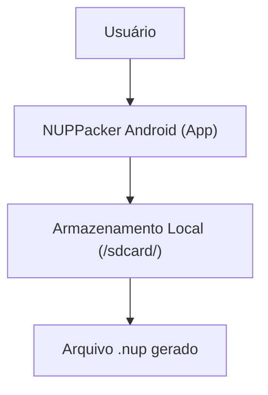
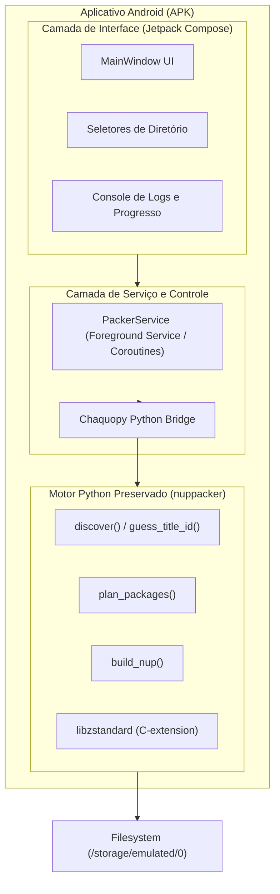
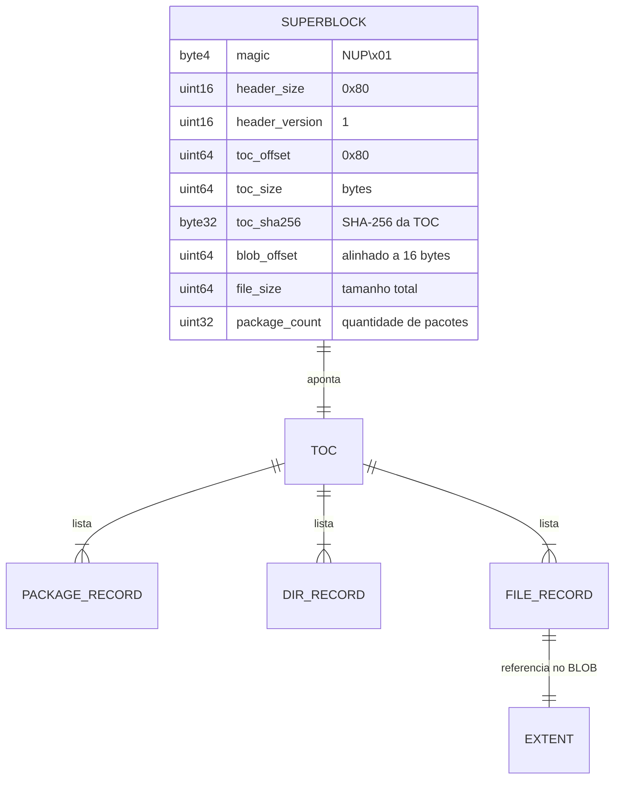
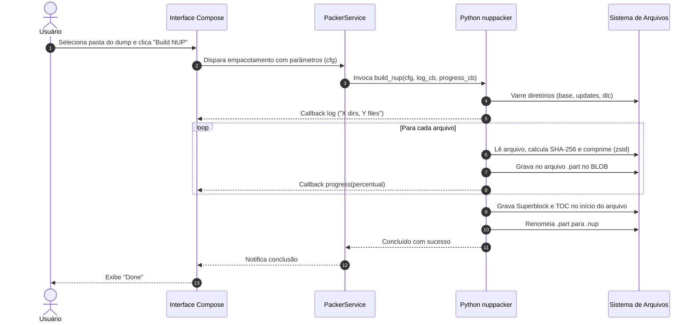

# Arquitetura — NUPPacker Android

## 1. Contexto (C4 Nível 1)

O NUPPacker Android opera inteiramente no dispositivo do usuário, lendo pastas de dumps de jogos descompactados e gerando um contêiner `.nup` otimizado para emuladores.

## 2. Contêineres e Componentes (C4 Níveis 2 e 3)

## 3. Modelo do Formato NUP (Binário)

## 4. Fluxo de Empacotamento (Sequência)

## 5. Decisões Arquiteturais
- [ADR 0001: Adoção de regras e governança](file:///home/nepo/Downloads/NUP/docs/adr/0001-adotar-regras-e-registro-de-decisoes.md)
- [ADR 0002: Stack Android e reaproveitamento do motor Python original](file:///home/nepo/Downloads/NUP/docs/adr/0002-stack-android-e-reaproveitamento-python.md)
- [ADR 0003: Licenciamento sob GNU AGPL v3](file:///home/nepo/Downloads/NUP/docs/adr/0003-licenciamento-agpl-3.md)

## 6. Pipeline de Construção (CI)
A compilação do APK ocorre primariamente no **GitHub Actions** via GitHub CLI (`gh`), utilizando o runner `ubuntu-latest`, JDK 17, Android SDK com CMake/NDK e Gradle Wrapper.
